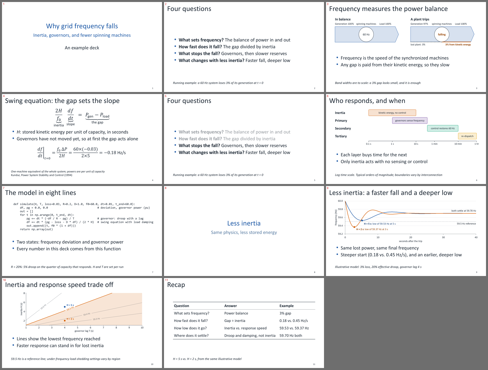

# powerpoint

A skill that helps AI coding agents make technical slides that are simple and consistent. Every deck is a normal PowerPoint file, edittable in any powerpoint software.

Works for any technical presentation subject area. It's guidance for the agent plus a few small tools.



## Install

You need [git](https://git-scm.com/downloads) and [uv](https://docs.astral.sh/uv/getting-started/installation/). Clone this repo into your agent's skills folder:

**Claude Code**

```
git clone https://github.com/willowhughes/powerpoint $HOME/.claude/skills/powerpoint
```

**Codex, Gemini CLI, Cursor, Copilot, Pi**

```
git clone https://github.com/willowhughes/powerpoint $HOME/.agents/skills/powerpoint
```

**Any other agent**

```
git clone https://github.com/willowhughes/powerpoint
```

Then tell your agent to read `powerpoint/SKILL.md`.

To let agents check their slides, you also need PowerPoint on Windows or [LibreOffice](https://www.libreoffice.org) elsewhere. The Python dependencies install themselves the first time the agent uses them.

## Start it

The skill only loads when you ask for it, so it stays out of your agent's way the rest of the time. Add your request after the command, in any folder:

| Agent | Command |
|---|---|
| Claude Code, Cursor, Copilot | `/powerpoint make a deck on ...` |
| Pi | `/skill:powerpoint make a deck on ...` |
| Codex | `$powerpoint make a deck on ...` |
| Gemini CLI | "Use the powerpoint skill to make a deck on ..." |

Gemini CLI has no manual-only setting, so it may also offer the skill on its own. It asks you to confirm before loading it.

## How it works

The skill teaches your agent how to design slides and points it to the helpers in this repo. The agent renders slides into images so it can see and fix its own work. Figures, equations, charts and tables are native PowerPoint objects whenever possible. When something has to be a picture, the agent tells you.

## Common workflows

**Make a deck together.** Tell your agent the topic and audience and share any notes or papers. It proposes slide titles and what each figure should show. Correct that first, then it builds the deck and you iterate on it.

**Use your own template.** Give it your `.pptx` or `.potx`: "Use `lab_template.pptx`." It builds on your layouts, colors and fonts.

**Edit a deck you already have.** "On slide 4, make the diagram show the cache miss path." You can freely mix your own edits in PowerPoint with the agent's, because the file itself is always the source of truth.

**Undo what the agent changed.** The agent backs up a deck before editing it, into `deck_versions/` next to your deck. Ask "show me what you changed" for old and new slides side by side, or "undo that" to put the backup back.

**Work with Google Slides.** Use File > Download > Microsoft PowerPoint, have the agent edit that file, then use File > Import slides to bring back only the slides that changed. Check equations and charts afterwards, since they may not come through as editable.

**Change the default look.** Open `assets/clean.pptx` and edit its theme in Slide Master.

## Update or remove

To update, run `git pull` in the skill's folder. To remove it, delete the folder.
